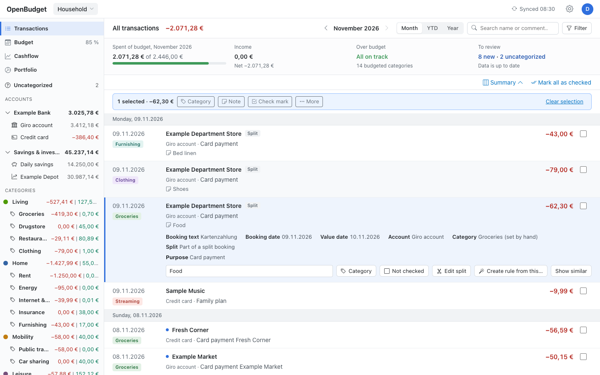
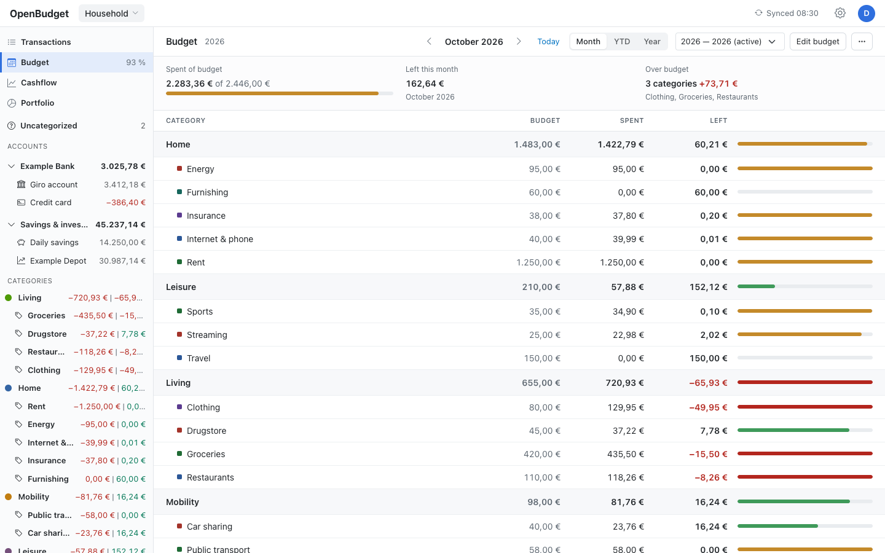
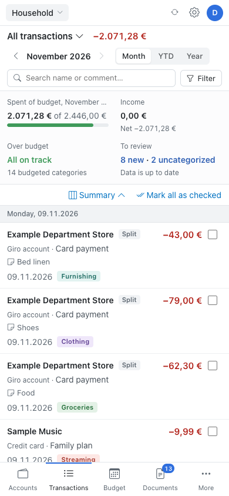

# OpenBudget

A self-hosted budgeting and cashflow app. Feed it your accounts and
transactions and you get per-project budgets, year-to-date variance reports,
and forward-looking balance projections.

<p>
  
</p>
<p>
  
  
</p>

More screenshots, including dark mode, are in [`docs/screenshots/`](docs/screenshots/). All data shown is a
fictional demo household.

## Features

- **Projects and budgets** — a project is a set of accounts and tracked categories with its own dashboard tile and
  yearly per-category budgets. Projects can be shared with other users as viewer or editor.
- **Cashflow** — projected balance trajectory, flagged when it dips below your floor.
- **Transactions** — browse, filter, categorize, add notes and check marks, with bulk edits, undo and keyboard
  shortcuts.
- **Bank connectors** — sync accounts and statement PDFs directly from banks (see below).
- **Importers** — a one-time move from MoneyMoney (uploaded in the browser) and PortfolioPerformance files.
- **Logins** — passwords and passkeys; English and German UI.

## Running it

Production via Docker (see [`docker-compose.yml`](docker-compose.yml)):

```bash
echo "OPENBUDGET_SECRETS_KEY=$(openssl rand -base64 32)" > .env
docker compose up -d
docker exec openbudget dotnet OpenBudget.dll users add <username> --admin
```

Until the first user exists, every page only shows a setup message. `users add` prints a generated password once
(use `-it` to be prompted, or `--password-stdin`). There is no sign-up page; other users are created the same way.

The container speaks plain HTTP on `:8080` and expects a TLS-terminating reverse proxy in front that sends
`X-Forwarded-Proto` and `X-Forwarded-Host` and passes WebSocket upgrades. Keep `/app/data` on a persistent volume: it
holds the database, statement PDFs and the data-protection keys that keep sessions valid across redeploys.

Local development:

```bash
dotnet run --project src/OpenBudget
```

### Environment variables

| Variable | Purpose |
| --- | --- |
| `OPENBUDGET_SECRETS_KEY` | Base64 256-bit key encrypting bank credentials and sessions. Required for connections. Not stored in the data volume; keep it safe and keep using the same value, or stored credentials must be re-entered. |
| `OPENBUDGET_FINTS_PRODUCT_ID` | FinTS product ID registered with the [Deutsche Kreditwirtschaft](https://www.fints.org/de/hersteller/produktregistrierung). Required for FinTS banks. |
| `OPENBUDGET_RP_ID` | Pins the passkey relying-party id (default: the request host). Changing it invalidates registered passkeys. |
| `CHROME_PATH` | Chromium for web logins outside Docker (the image ships one). |
| `OPENBUDGET_ONEDRIVE_CLIENT_ID`, `_SECRET`, `_TENANT` | Entra ID app registration for reading PortfolioPerformance files from OneDrive and receipts from Microsoft 365 mail; the features are hidden without them. Delegated Microsoft Graph permissions: `Files.Read.All`, `offline_access`, `openid`, `profile`, and `Mail.Read` for receipts. |
| `OPENBUDGET_ENABLE_FAKE_BANK` | `true` offers a made-up bank for trying out connectors. |
| `OPENBUDGET_OPENAI_API_KEY` | Turns on AI suggestions (see below); without it the AI settings are hidden. Not stored in the data volume. |
| `OPENBUDGET_OPENAI_MODEL` | Model for AI suggestions (default `gpt-6.1-terra`). |
| `OPENBUDGET_OPENAI_BASE_URL` | Another OpenAI-compatible endpoint (default `https://api.openai.com/v1`); `https://eu.api.openai.com/v1` processes requests in Europe (the project needs EU data residency or an eligible retention setting). |
| `OPENBUDGET_OPENAI_CATEGORY_ROUTE` | `responses` (default) or `decisions`: choose booking categories with the Decisions API (faster, cheaper, probabilities instead of a rationale, no AI rule proposals). |
| `OPENBUDGET_OPENAI_DECISIONS_MODEL` | Model for the Decisions route (default `gpt-6-luna`). |

### User commands

```bash
docker exec openbudget dotnet OpenBudget.dll users add <name> [--admin] [--password-stdin | --generate-password]
docker exec openbudget dotnet OpenBudget.dll users list
docker exec openbudget dotnet OpenBudget.dll users set-password <name> [--password-stdin | --generate-password]
docker exec openbudget dotnet OpenBudget.dll users remove <name> --yes
docker exec openbudget dotnet OpenBudget.dll users claim <name>
```

A new user takes over an unowned source of the same name and its projects; `users claim` repeats that for an
existing user. `--admin` grants no access to other users' data.

## Suggestions

"Suggest categories" in Uncategorized proposes a category per booking from the project's rules, earlier bookings
with the same counterparty IBAN and similar categorized bookings, and offers rules for recurring patterns (with how
many bookings they match and how many already have another category). "Suggest budget" in the budget editor proposes
monthly amounts from the last up to three years, leaving out unusual one-off bookings and placing recurring payments
in their months. Nothing is applied until accepted.

With `OPENBUDGET_OPENAI_API_KEY` set, each user can turn on AI suggestions (Settings → AI suggestions, which also
previews what is sent). Only bookings the app is unsure about are sent, with date, amount, payee, cleaned purpose,
booking code and account type, plus the category names and rules; IBANs, references, card numbers, account names,
balances and the users' names are removed. Bookings of another user's accounts are only sent if that user opted in
too. Requests use the Responses API with `store: false`; with `OPENBUDGET_OPENAI_CATEGORY_ROUTE=decisions` categories
are chosen with the Decisions API instead (one request per booking), while rules and budgets stay on the Responses API.

## Bank connectors

Connections (Settings → Connections) belong to one user and sync only while that user has OpenBudget open (there is no background fetching).
TANs, app approvals and captchas are answered in a dialog. Accounts imported from MoneyMoney can be switched to
the bank connection, which then becomes the account's source of truth.

- **ING** — FinTS for current and savings accounts; web banking for VL savings and the postbox.
- **Baader Bank** — FinTS: cash account and depot positions.
- **PSD Bank Nürnberg** — FinTS: accounts and account statement PDFs.
- **Scalable Capital** — web login on Scalable's own page; depots, cash accounts and mailbox documents.
- **PayPal** — web login; one account per currency from PayPal's activity download.
- **Openbank** (Germany) — web login; credit cards.
- **Kraken** — read-only API key; balances as one EUR-valued depot account.

Web logins show the bank's sign-in page, running in a server-side Chromium, live in the browser; you sign in there
yourself. The Docker image includes Chromium and Xvfb.

## Importers

**Get started** (gear menu) leads a new user through connections, the optional imports and the first settings.

- **MoneyMoney** — a one-time move of the history: in MoneyMoney choose Help › Show Database in Finder…, quit
  MoneyMoney, compress the folder that contains `Database` and `Statements`, and upload the ZIP with the MoneyMoney
  password. The upload goes in chunks (so reverse-proxy body limits don't matter); the server decrypts the database
  with SQLCipher and imports accounts, categories, bookings and the stored statements in the background. The password
  is not stored; the upload and the decrypted copy are deleted afterwards. Then switch the accounts to their bank
  connections (or keep them as manual accounts) and **finish the MoneyMoney import**.
- **PortfolioPerformance** — link the `.portfolio` file on OneDrive (read on the server, kept current) or upload it
  on the Portfolio Performance page.
- **Receipts** — on the Receipts page, grant mail access (a Microsoft sign-in asking for `Mail.Read`; add that
  delegated permission to the app registration's API permissions first). OpenBudget then reads REWE online-order
  invoices (subject "Deine Rechnung zu B-…", PDF attachment) about every hour, matches each with its direct debit
  (same amount, payee REWE, up to ten days after delivery), and in-store eBons ("Dein REWE eBon vom …", matched with
  the card or PAYBACK PAY payment up to five days later; cash-only receipts are kept but not matched), and splits the booking by category: food stays in the
  booking's category, non-food items (by keyword) go to the category chosen there, deposit and delivery lines stay
  with the food, the redeemed bonus is spread over the discountable items. Moving an item to another category in the
  booking's details re-splits it and is remembered for that product. Bookings categorized or split by hand are left
  as they are. With AI suggestions on, products neither the memory nor the keywords place are asked about by name.

## Development

```bash
tools/check.sh              # build, unit and E2E tests
tools/check.sh --unit-only  # skip E2E
dotnet test tests/OpenBudget.E2E.Tests --filter Category=Screenshots   # regenerate screenshots
```

- `src/OpenBudget/` — the app (Blazor Server, .NET 11 preview, EF Core + SQLite, ASP.NET Core Identity)
- `src/OpenBudget/Connectors/` — bank connectors, one folder each; `FinTs/` is the built-in FinTS client
- `src/OpenBudget/Importers/` — importers
- `tests/` — unit tests (`OpenBudget.Tests`) and Playwright E2E tests (`OpenBudget.E2E.Tests`)
